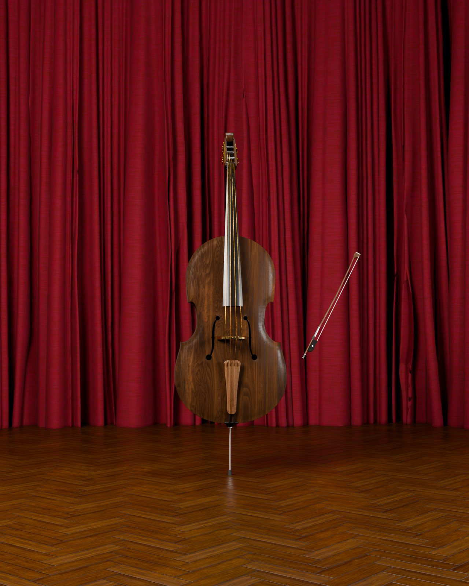
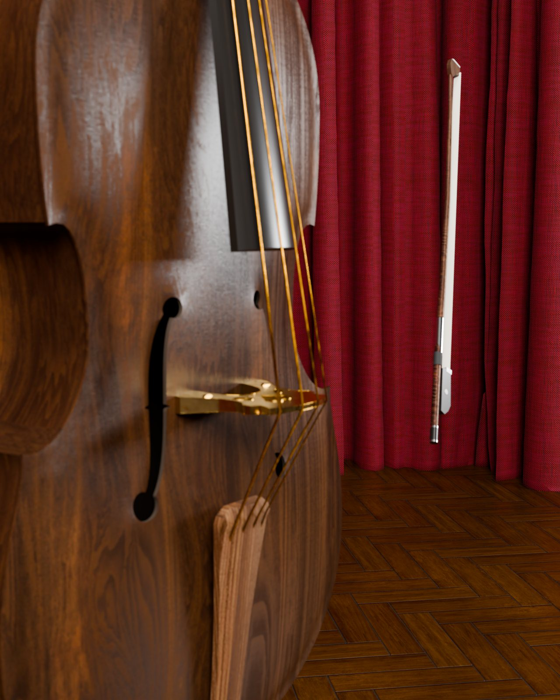
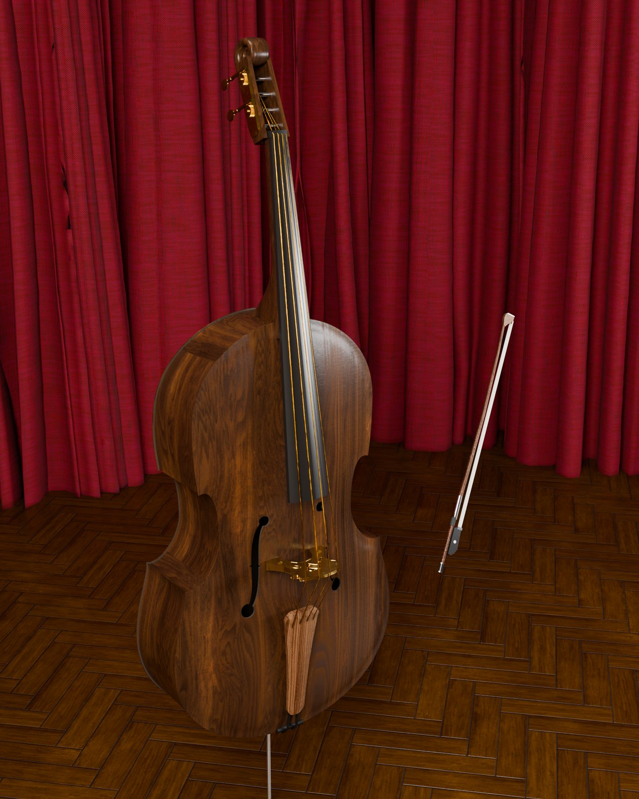

# Kontrabass: 3D-Konfigurator

Ein Kontrabass, modelliert in Blender, als interaktiver 3D-Konfigurator im Browser.
ITP-Projekt „3D-Objekt im Web“ an der HTL Shkodër, 2026. Regis Balla.

- **Website:** https://kontrabass-itp-projekt.vercel.app

## Die Idee

Der Kontrabass steht allein auf einer kleinen Bühne mit rotem Vorhang und Parkettboden, wie vor einem Konzert.
Man kann um ihn herumgehen, ihn von nah ansehen, seine Teile kennenlernen und ihn selbst zusammenstellen.
Wenn man die Musik startet, spielt er ein Stück aus Bachs Cellosuiten (Prélude oder Bourrées), und der Bogen streicht über die Saiten.

## Das 3D-Modell

Der Bass ist ein 3/4-Kontrabass in echter Größe: 2,1 m hoch mit Stachel, 111 cm Korpus, 105 cm Mensur.
Das Modell hat ungefähr 93.000 Dreiecke und besteht aus 17 einzelnen Teilen, zum Beispiel Korpus, Hals,
Schnecke, Mechanik, Griffbrett, Steg, Saitenhalter, vier Saiten und Stachel. Dazu kommt der Bogen.

- **Material:** poliertes Nussbaumholz, ein goldener Steg, goldene Saiten und eine Mechanik in Altgold.
- **Shape Key „Gambenform“:** Der Korpus hat zwei Formen. Die Violinform hat runde Schultern und Ecken,
  die Gambenform hat schräge, hängende Schultern wie die alte Viola da Gamba.
  Beide Formen sind dasselbe Mesh, nur die Punkte am Rand liegen anders.
- **Bühne:** Vorhang und Parkett sind ein eigenes Modell. Im Browser wird der Vorhang ein zweites Mal
  vorne aufgestellt, damit der Raum von allen Seiten geschlossen ist.
- **Export:** Bass und Bühne sind als `.glb` exportiert. Die Blender-Materialien sind dabei vereinfacht,
  weil ein Browser keine Blender-Knoten wie Color Ramp oder Noise lesen kann.

## Der Konfigurator

Sechs Eigenschaften kann man ändern:

| Eigenschaft  | Was sich ändert                              | Optionen                                  |
| ------------ | -------------------------------------------- | ----------------------------------------- |
| Form         | die **Geometrie** vom Korpus (Morph Target)  | Violinform, Gambenform                    |
| Lack         | die Farbe vom Holz                           | Nussbaum, Rotbraun, Honig, Antik, Schwarz |
| Saitenhalter | das Holz vom Saitenhalter                    | Nussbaum, Palisander, Ebenholz, Buchsbaum |
| Saiten       | Farbe und Material (Metall oder Darm, Glanz) | Gold, Kupfer, Stahl, Darm                 |
| Mechanik     | die Farbe vom Metall                         | Altgold, Messing, Nickel, Schwarz         |
| Bogen        | Bogen zeigen oder verstecken                 | an, aus                                   |

Alle Änderungen passieren mit einem weichen Übergang, nicht mit einem Sprung.

Dazu gibt es:

- **Kamera:** drehen, zoomen und verschieben mit der Maus, dazu sechs feste Ansichten (Gesamt, Vorne, Seite,
  Rücken, Steg, Schnecke). Die Kamera fliegt weich von einer Ansicht zur nächsten.
- **Rote Punkte am Modell:** Acht Teile haben eine Markierung. Ein Klick fliegt heran und öffnet eine Infokarte.
  Beim Griffbrett kann man die Saiten E, A, D und G anhören, und die Saite schwingt im Modell.
- **Teile zeigen:** Der Bass fliegt langsam in seine 17 Teile auseinander und wieder zusammen.
- **Licht:** Bühnenlicht mit zwei Scheinwerfern und Schatten, oder Kerzenlicht mit flackernden Kerzen.
- **Musik:** Bach, Cellosuite Nr. 1 (Prélude) und Nr. 3 (Bourrées), eine Oktave tiefer, damit es wie ein Kontrabass klingt.
  Solange die Musik läuft, liegt der Bogen auf den Saiten und streicht passend zur Lautstärke.
- **Drehteller:** Nach 10 Sekunden ohne Maus dreht sich der Bass langsam von selbst.
- **Bild speichern:** speichert den Bass so, wie er gerade aussieht, als PNG.
- **Ladeanzeige** in Prozent, solange das Modell lädt.

Unter dem Konfigurator zeigt die Website einen Katalog der acht Teile (mit Bildern aus Blender),
die Renderings und eine technische Zeichnung mit den Maßen. Die Zeichnung zeigt die gewählte Korpusform.

## Renderings

Gerendert in Blender mit Cycles, auf derselben Bühne wie im Konfigurator.

| Gesamtansicht                                    | Detail                                          | Andere Perspektive                         |
| ------------------------------------------------ | ----------------------------------------------- | ------------------------------------------ |
|  |  |  |

## Technik

- **SvelteKit** (Svelte 5) für die Website, mit `adapter-static` als fertige Dateien gebaut
- **Threlte** und **Three.js** für die 3D-Szene
- **Tailwind CSS** für das Design, Schrift: Archivo
- **Web Audio API** für die Musik und die gezupften Saiten
- **Vercel** für die Veröffentlichung

Alle Daten (Farben, Kameras, Texte, Maße) stehen an einem Ort: `src/lib/data.js`.

Lokal starten:

```bash
npm install
npm run dev
```

## Quellen

Musik: J. S. Bach, Cellosuite Nr. 1 G-Dur, BWV 1007, [Prélude](https://commons.wikimedia.org/wiki/File:JOHN_MICHEL_CELLO-J_S_BACH_CELLO_SUITE_1_in_G_Prelude.ogg)
und Cellosuite Nr. 3 C-Dur, BWV 1009, [Bourrées](https://commons.wikimedia.org/wiki/File:JOHN_MICHEL_CELLO-J_S_BACH_CELLO_SUITE_3_in_G_Bourees.ogg).
Aufnahmen von John Michel (Cello), Wikimedia Commons, Lizenz [CC BY-SA 3.0](https://creativecommons.org/licenses/by-sa/3.0/).
Für dieses Projekt eine Oktave tiefer bearbeitet. Die bearbeiteten Dateien stehen ebenfalls unter CC BY-SA 3.0.